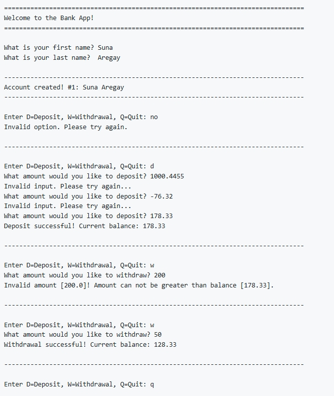

<!-- 
https://github.com/lifeparticle/Markdown-Cheatsheet
https://youtu.be/eVGEea7adDM?si=cz1Fbqxr9VgioIEh
-->

# Java - Bank App
CSC 160 Programming Fundamentals II: Section 2 assignment

<b>Table of Content</b>
- [Assignment Overview](#assignment-overview)
- [How the Program Works](#how-the-program-works)
- [Sample Output](#sample-output)
- [New Concepts](#new-concepts)
- [Maintainers](#maintainers)

## Assignment Overview
📚 This project is a console-based Banking Application built in Java using Object-Oriented Programming principles. The application allows a user to create a bank account and perform basic banking operations such as deposits and withdrawals while enforcing proper validation and error handling.

## How the Program Works
1. Displays a welcome message.

2. Prompts the user for their first and last name.

3. Creates a new account with:

    - An auto-generated account ID

    - The user’s full name

    - A starting balance of $0.00

4. Prompts the user repeatedly to:

    - Deposit money

    - Withdraw money

    - Quit the program

5. Validates all inputs:

    - Rejects invalid menu options

    - Rejects invalid monetary values

    - Prevents withdrawals greater than the current balance

6. Displays updated account balance after successful transactions.

## Sample Output

# New Concepts
- Object-Oriented Programming (OOP)

- Working with methods

- Constructors

- Method overriding (toString())

- Exception handling

- Throwing custom errors

- Input validation

## Maintainers
[@suna2km](https://github.com/suna2km) Suna Aregay

[Back to Top](#java---invoice-app)
